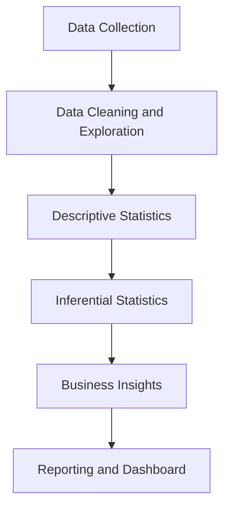
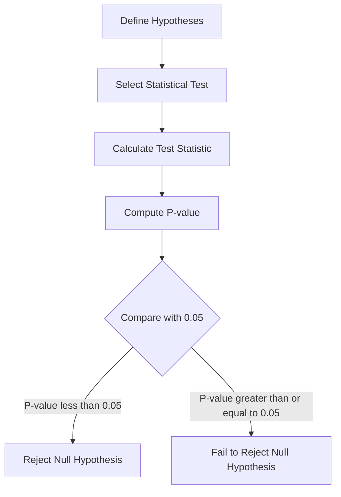
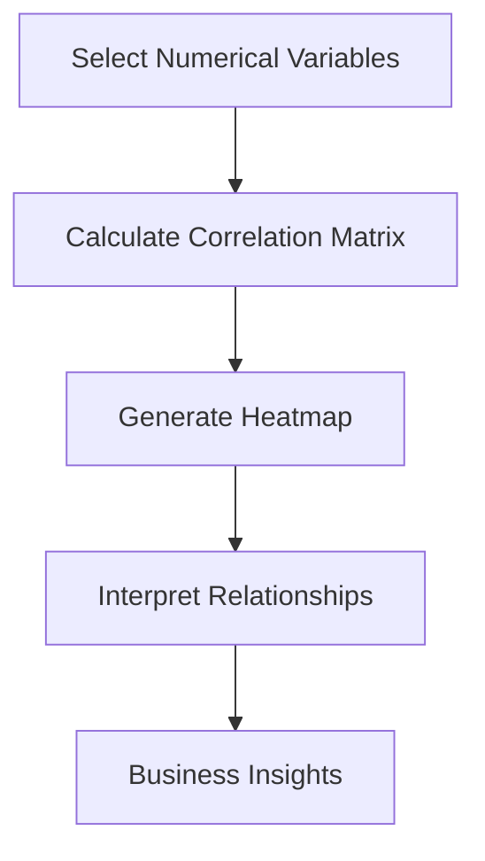
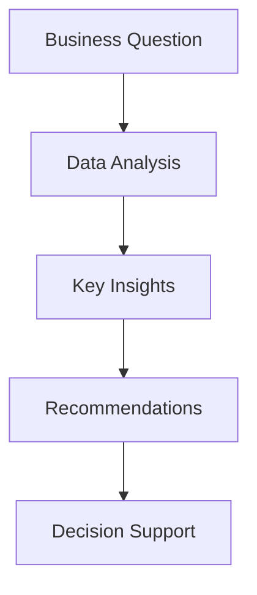

# SUPERSTORE SALES DATA ANALYSIS

## Statistical Analysis, Probability, Hypothesis Testing, Correlation Analysis and Business Insights

**Project:** Data Analysis with Python – Internship Task 3

**Dataset:** Superstore Sales Dataset

**Tools:** Python 3.12, Pandas, NumPy, SciPy, Matplotlib, Seaborn

**Environment:** Visual Studio Code and Jupyter Notebook

---

# 1. Executive Summary

This project focuses on analyzing Superstore sales data using Python statistical and data analysis techniques. The main objective is to understand business performance, identify important patterns, examine relationships between variables, and generate meaningful business recommendations.

The dataset contains 9,994 sales records with information about sales, profit, quantity, region, product category, customer segment, and order dates.

The analysis includes descriptive statistics, probability fundamentals, probability distributions, sampling techniques, confidence intervals, hypothesis testing, correlation analysis, and business performance evaluation.

The project identified total sales of **2,297,200.86** and total profit of **286,397.02**, with an overall profit margin of approximately **12.47%**.

The West region recorded the highest sales and profit among the four regions. Technology generated the highest sales and profit among the three product categories, while Furniture recorded a comparatively low profit margin of approximately 2.49%.

Statistical tests were conducted to examine sales performance and relationships between business variables. Correlation analysis showed a moderate positive relationship between sales and profit.

An executive dashboard and supporting Excel, CSV, and PDF reports were also created to communicate the findings clearly.

The project demonstrates how statistical analysis and Python programming can support evidence-based business decisions.

---

# 2. Introduction

Businesses generate large amounts of data through their daily operations. Analyzing this information helps organizations understand performance, identify trends, evaluate business activities, and make informed decisions.

Statistical analysis plays an important role in transforming raw business data into meaningful information. It helps analysts summarize data, measure variation, understand probability, test assumptions, and identify relationships between variables.

In this project, the Superstore sales dataset is analyzed using Python. Different statistical methods and visualization techniques are applied to study sales, profit, quantity, regional performance, product categories, and customer segments.

The project also includes hypothesis testing, confidence interval estimation, correlation analysis, and the development of an executive dashboard.

The final objective is to present analytical findings in a clear and understandable format and provide practical recommendations based on the results.

---

# 3. Project Objectives

The main objectives of this project are:

- Analyze the Superstore sales dataset using Python.

- Calculate descriptive statistical measures.

- Understand probability and probability distributions.

- Apply random, stratified, and systematic sampling techniques.

- Calculate confidence intervals.

- Perform hypothesis testing using SciPy.

- Analyze relationships using Pearson and Spearman correlation.

- Evaluate regional, category, and customer segment performance.

- Identify important business trends and insights.

- Develop an executive dashboard.

- Generate business reports in Excel, CSV, and PDF formats.

---

# 4. Dataset Description

The Superstore dataset is used to analyze business sales performance. It contains 9,994 records and 11 columns.

## 4.1 Dataset Columns

The dataset includes the following fields:
| Column | Description |
|---|---|
| Order Date | Date of the order |
| Region | Geographical sales region |
| State | State where the sale occurred |
| Category | Main product category |
| Sub-Category | Specific product sub-category |
| Segment | Customer segment |
| Sales | Sales value |
| Profit | Profit or loss value |
| Quantity | Number of products sold |
| Month | Month of the order |
| Year | Year of the order |
## 4.2 Dataset Overview

The dataset provides information about sales transactions, product categories, geographical regions, and customer segments.

It is used to evaluate:

- Overall sales and profit performance.

- Regional business performance.

- Product category and sub-category performance.

- Customer segment contribution.

- Monthly sales trends.

- Statistical relationships between numerical variables.

# 5. Tools and Technologies

The following tools and Python libraries were used in this project.
| Tool / Library | Purpose |
|---|---|
| Python 3.12 | Main programming language |
| Visual Studio Code | Development environment |
| Jupyter Notebook | Writing and executing analysis |
| Pandas | Data loading, manipulation and analysis |
| NumPy | Numerical calculations |
| SciPy | Statistical tests and probability distributions |
| Matplotlib | Data visualization |
| Seaborn | Statistical charts and heatmaps |
| OpenPyXL | Excel report generation |
| ReportLab | PDF report generation |
# 6. Project Methodology

The project follows a structured data analysis workflow to transform the dataset into useful business insights.

## 6.1 Data Loading

The dataset was imported into Python using the Pandas library.

The CSV file was loaded into a Pandas DataFrame for further analysis.

## 6.2 Data Exploration

The dataset was examined to understand its structure, columns, and records.

The shape and available variables were reviewed before performing statistical calculations.

## 6.3 Statistical Analysis

Descriptive statistics were calculated to understand the distribution and variation of sales values.

Probability concepts and probability distributions were explored using Python and SciPy.

## 6.4 Sampling and Inferential Analysis

Random, stratified, and systematic sampling techniques were applied.

Confidence intervals and hypothesis tests were used to examine statistical findings.

## 6.5 Correlation and Business Analysis

Correlation and covariance were calculated to examine relationships between sales, profit, and quantity.

Business performance was evaluated across regions, product categories, sub-categories, and customer segments.

## 6.6 Visualization and Reporting

Charts, a correlation heatmap, and an executive dashboard were created using Matplotlib and Seaborn.

The findings were exported into CSV, Excel, and PDF reports.

---

# 7. Descriptive Statistical Analysis

Descriptive statistics are used to summarize and understand the main characteristics of a dataset.

In this project, descriptive statistical analysis was performed on the Sales column to understand the distribution, central tendency, and variation in sales values.

## 7.1 Measures of Central Tendency

The following measures were calculated:

- **Mean:** The average sales value.

- **Median:** The middle value when sales records are arranged in ascending order.

- **Mode:** The most frequently occurring sales value.

The calculated average sales value was approximately **229.86**.

## 7.2 Measures of Dispersion

Measures of dispersion help understand how widely sales values are spread.

The following statistical measures were calculated:

- **Range:** Difference between the maximum and minimum sales values.

- **Variance:** Measures the squared variation of sales values from the mean.

- **Standard Deviation:** Measures the typical spread of sales values around the mean.

## 7.3 Quartiles and Interquartile Range

Quartiles divide the dataset into four equal parts.

- **Q1:** First quartile (25th percentile).

- **Q2:** Second quartile (50th percentile or median).

- **Q3:** Third quartile (75th percentile).

- **IQR:** Difference between Q3 and Q1.

The Interquartile Range helps understand the spread of the middle 50% of sales values.

## 7.4 Data Visualization

A histogram and a box plot were created using Matplotlib and Seaborn.

The histogram helps visualize the distribution of sales values.

The box plot helps identify the median, quartiles, spread, and potential outliers.

The generated charts were saved in the project's `charts` folder.

## 7.5 Importance of Descriptive Statistics

Descriptive statistics provide an initial understanding of business performance.

They help identify typical sales values, variation in transactions, and unusual observations that may require further investigation.

---

# 8. Probability Fundamentals

Probability is a statistical concept used to measure the likelihood of an event occurring.

In this project, probability techniques were applied to understand profitable sales records and examine relationships between business events.

## 8.1 Basic Probability

The probability of an event is calculated as:

Probability = Number of favourable outcomes / Total number of outcomes

The analysis identified:

- Total sales records: 9,994

- Profitable records: 8,058

- Probability of a record being profitable: approximately 80.63%

This indicates that approximately 80.63% of the analyzed records had positive profit.

## 8.2 Conditional Probability

Conditional probability measures the probability of an event occurring when another event is already known to have occurred.

In this analysis, the probability of a profitable record given that the record belonged to the East region was calculated.

Result:

**P(Profitable | East) = 79.92%**

This means approximately 79.92% of the East region records were profitable.

## 8.3 Independent Events

Two events are independent when the occurrence of one event does not change the probability of the other.

The probability of a record belonging to the East region and being profitable was compared with the product of their individual probabilities.

- P(East) = 0.28497

- P(Profitable) = 0.80628

- P(East) × P(Profitable) = 0.22977

- P(East and Profitable) = 0.22774

The values are close but not exactly equal. Therefore, the events are not exactly independent in this dataset.

## 8.4 Random Variables and Expected Value

Profit was treated as a numerical random variable.

The expected value was calculated using the mean profit.

- Mean profit: approximately 28.66

- Minimum profit: approximately -6,599.98

- Maximum profit: approximately 8,399.98

The expected value represents the average profit per record in the dataset.

## 8.5 Business Interpretation

Probability analysis helps estimate the likelihood of profitable transactions and understand business performance across different regions.

The results show that most records were profitable, while conditional probability provides additional information about profitability within a specific region.

---

# 9. Probability Distributions

Probability distributions describe how the values of a random variable are distributed.

In this project, four probability distributions were explored using Python and SciPy.

## 9.1 Normal Distribution

The normal distribution is a continuous probability distribution that has a bell-shaped curve.

It was explored to understand how numerical values can be distributed around a central value.

## 9.2 Uniform Distribution

The uniform distribution represents a situation where values within a specified range have equal probability.

A sample of 1,000 random values was generated between 10 and 100 using NumPy.

## 9.3 Binomial Distribution

The binomial distribution describes the probability of a fixed number of successes in a fixed number of independent trials.

In this project:

- Number of trials (n) = 10

- Probability of success (p) = 0.8063

- Probability of exactly 8 successes was calculated using SciPy.

## 9.4 Poisson Distribution

The Poisson distribution is used to model the probability of a number of events occurring within a fixed interval when the average event rate is known.

An illustrative average rate (λ) of 5 was used, and the probability of exactly 3 events was calculated using SciPy.

This was a demonstration of the distribution rather than a rate estimated from the Superstore dataset.

## 9.5 Importance of Probability Distributions

Probability distributions help analysts understand uncertainty and model possible outcomes.

They are useful in business applications such as demand analysis, transaction patterns, risk assessment, and forecasting.

---

# 10. Sampling Techniques

Sampling is the process of selecting a smaller group of records from a larger dataset for analysis.

In this project, three sampling techniques were applied to the Superstore dataset.

## 10.1 Random Sampling

Random sampling selects records from the dataset randomly.

A random sample of 100 records was selected using Pandas.

A fixed random state of 42 was used to make the sample reproducible.

## 10.2 Stratified Sampling

Stratified sampling divides the dataset into groups called strata and selects samples from each group.

In this project, the Region column was used to create the groups.

A 10% sample was selected from each region to ensure regional representation.

## 10.3 Systematic Sampling

Systematic sampling selects records at regular intervals from an ordered dataset.

Every 10th record was selected from the Superstore dataset.

The original average sales value was approximately 229.86, while the systematic sample average was approximately 266.00.

The difference indicates that the systematic sample did not produce the same average as the complete dataset.

## 10.4 Sampling Bias

Sampling bias occurs when a selected sample does not adequately represent the population.

The regional distribution of the samples was compared to understand whether some regions were overrepresented or underrepresented.

The systematic sampling result also demonstrates why sample selection methods and the ordering of records should be considered carefully.

## 10.5 Importance of Sampling

Sampling techniques reduce the amount of data required for certain analyses and help analysts study large datasets efficiently.

Selecting an appropriate sampling method is important for obtaining representative and reliable results.

---

# 11. Hypothesis Testing

Hypothesis testing is a statistical method used to evaluate assumptions about a population using sample data.

In this project, three statistical tests were performed using the SciPy library.

A significance level of 0.05 (5%) was used to interpret the test results.

## 11.1 One-Sample T-Test

A one-sample t-test was performed to compare the average sales value with an illustrative benchmark of 200.

**Hypotheses:**

- Null Hypothesis (H0): The population mean sales value is 200.

- Alternative Hypothesis (H1): The population mean sales value is different from 200.

**Results:**

- Sample mean: 229.86

- Test statistic: 4.7893

- P-value: 0.0000016977

**Conclusion:**

Since the p-value is less than 0.05, the null hypothesis was rejected.

The sample provides statistically significant evidence that the mean sales value differs from the benchmark of 200.

## 11.2 Independent T-Test

An independent Welch's t-test was performed to compare the average sales values of the East and West regions.

**Hypotheses:**

- Null Hypothesis (H0): The population mean sales values of the East and West regions are equal.

- Alternative Hypothesis (H1): The population mean sales values of the East and West regions are different.

**Results:**

- East region average sales: 238.34

- West region average sales: 226.49

- Test statistic: 0.7961

- P-value: 0.4260

**Conclusion:**

Since the p-value is greater than 0.05, the null hypothesis was not rejected.

There is insufficient statistical evidence to conclude that the population mean sales values differ between the East and West regions.

## 11.3 Chi-Square Test

A Chi-Square Test of Independence was performed to examine the relationship between Region and Profit Status.

Profit Status was classified into two groups:

- Profitable

- Non-Profitable

**Hypotheses:**

- Null Hypothesis (H0): Region and Profit Status are independent.

- Alternative Hypothesis (H1): Region and Profit Status are associated.

**Results:**

- Chi-square statistic: 416.4449

- Degrees of freedom: 3

- P-value: 6.0659 × 10⁻⁹⁰

**Conclusion:**

Since the p-value is less than 0.05, the null hypothesis was rejected.

The results indicate a statistically significant association between Region and Profit Status. However, this does not establish a causal relationship.

## 11.4 Summary of Hypothesis Tests
| Statistical Test | P-value | Decision |
|---|---:|---|
| One-Sample T-Test | 0.0000016977 | Reject H0 |
| Independent T-Test | 0.4260 | Fail to reject H0 |
| Chi-Square Test | 6.0659 × 10⁻⁹⁰ | Reject H0 |
## 11.5 Importance of Hypothesis Testing

Hypothesis testing helps businesses evaluate assumptions using statistical evidence.

It supports better decision-making by identifying statistically significant differences and associations in business data.

---

# 12. Confidence Interval Analysis

A confidence interval is a range of values used to estimate an unknown population parameter based on sample data.

In this project, a 95% confidence interval was calculated for the mean sales value using the SciPy library.

## 12.1 Methodology

The following steps were performed:

1. Calculate the mean sales value.

2. Calculate the standard error.

3. Apply the t-distribution to estimate the confidence interval.

4. Interpret the lower and upper confidence limits.

## 12.2 Results
| Metric | Value |
|---|---:|
| Mean Sales | 229.86 |
| Lower Confidence Limit | 217.64 |
| Upper Confidence Limit | 242.08 |
| Confidence Level | 95% |
The calculated 95% confidence interval is:

**217.64 to 242.08**

## 12.3 Interpretation

The interval provides a range of plausible values for the population mean sales value under the assumptions of the confidence interval method.

The confidence interval visualization was generated and saved in the project's charts folder.

## 12.4 Business Importance

Confidence intervals help businesses understand the uncertainty associated with estimates.

They provide more information than a single average value and support evidence-based business analysis.

---

# 13. Correlation Analysis and Business Analytics

Correlation analysis is used to measure the strength and direction of relationships between numerical variables.

In this project, Sales, Profit, and Quantity were selected for correlation analysis.

## 13.1 Correlation Matrix

The correlation matrix was calculated using Pandas.
| Variables | Correlation |
|---|---:|
| Sales and Profit | 0.4791 |
| Sales and Quantity | 0.2008 |
| Profit and Quantity | 0.0663 |
## 13.2 Pearson Correlation

Pearson correlation measures the strength and direction of a linear relationship between two numerical variables.

The Pearson correlation between Sales and Profit was approximately **0.4791**.

This indicates a moderate positive linear relationship between sales and profit.

## 13.3 Spearman Correlation

Spearman correlation measures the strength and direction of a monotonic relationship between two variables using their ranks.

The Spearman correlation between Sales and Profit was approximately **0.5184**.

This indicates a moderate positive monotonic relationship.

## 13.4 Covariance

Covariance measures how two variables change together.

The calculated covariance between Sales and Profit was approximately **69,944.10**.

The positive value indicates that Sales and Profit tend to move in the same direction.

## 13.5 Correlation Heatmap

A correlation heatmap was created using Seaborn.

The heatmap provides a visual representation of the relationships between Sales, Profit, and Quantity.

The chart was saved in the project's charts folder.

## 13.6 Business Interpretation

The analysis indicates a moderate positive relationship between Sales and Profit.

The relationship between Sales and Quantity is weaker, while Profit and Quantity have a very weak positive correlation.

Correlation does not establish causation. Other business factors may also influence profitability.

# 14. Business Performance Analysis

Business performance was evaluated using key performance indicators (KPIs) and comparisons across regions, product categories, sub-categories, and customer segments.

## 14.1 Key Performance Indicators

The following KPIs were calculated:
| KPI | Result |
|---|---:|
| Total Sales | 2,297,200.86 |
| Total Profit | 286,397.02 |
| Total Sales Records | 9,994 |
| Total Quantity Sold | 37,873 |
| Average Sales | 229.86 |
| Profit Margin | 12.47% |
Profit margin was calculated as:

Profit Margin = (Total Profit / Total Sales) × 100

## 14.2 Regional Performance

Regional analysis was performed to compare sales, profit, and quantity across four regions.
| Region | Sales | Profit | Quantity |
|---|---:|---:|---:|
| Central | 501,239.89 | 39,706.36 | 8,780 |
| East | 678,781.24 | 91,522.78 | 10,618 |
| South | 391,721.91 | 46,749.43 | 6,209 |
| West | 725,457.82 | 108,418.45 | 12,266 |
The West region recorded the highest sales, profit, and quantity.

The South region recorded the lowest sales and quantity.

## 14.3 Category Performance

The dataset contains three main product categories.
| Category | Sales | Profit | Quantity |
|---|---:|---:|---:|
| Furniture | 741,999.80 | 18,451.27 | 8,028 |
| Office Supplies | 719,047.03 | 122,490.80 | 22,906 |
| Technology | 836,154.03 | 145,454.95 | 6,939 |
Technology recorded the highest sales and profit.

Office Supplies recorded the highest quantity sold.

Furniture recorded the lowest profit among the three categories.

## 14.4 Category Profit Margins
| Category | Profit Margin |
|---|---:|
| Furniture | 2.49% |
| Office Supplies | 17.04% |
| Technology | 17.40% |
Technology recorded the highest profit margin, while Furniture had the lowest.

## 14.5 Sub-Category Analysis

Sub-category performance was evaluated using total profit.

The analysis identified Copiers as the highest-profit sub-category and Tables as the sub-category with the largest loss.

This comparison helps identify products that perform strongly and those that may require further investigation.

## 14.6 Customer Segment Analysis

Sales and profit were also analyzed across three customer segments.
| Segment | Sales | Profit | Quantity |
|---|---:|---:|---:|
| Consumer | 1,161,401.35 | 134,119.21 | 19,521 |
| Corporate | 706,146.37 | 91,979.13 | 11,608 |
| Home Office | 429,653.15 | 60,298.68 | 6,744 |
Consumer generated the highest sales and profit.

Home Office recorded the highest profit margin at approximately 14.03%.

## 14.7 Monthly Sales Trend

Monthly sales were analyzed using the order date.

The data was grouped by year and month to understand changes in sales over time.

A monthly sales trend chart was created to support the visual analysis of business performance.

---

# 15. Executive Dashboard Development

An executive dashboard was developed to present important business performance indicators and analytical findings in a visual format.

The dashboard combines key performance indicators and business charts to help users understand the overall performance of the Superstore dataset.

## 15.1 Dashboard Components

The executive dashboard includes:

1. KPI Overview

2. Regional Sales Analysis

3. Regional Profit Analysis

4. Category Sales Analysis

5. Category Profit Analysis

6. Monthly Sales Trend

## 15.2 KPI Overview

The dashboard presents important business metrics, including:

- Total Sales

- Total Profit

- Total Sales Records

- Total Quantity Sold

- Average Sales

- Profit Margin

## 15.3 Regional and Category Visualizations

Regional charts compare sales and profit across the four regions.

Category charts compare sales and profit across Furniture, Office Supplies, and Technology.

The monthly sales trend chart provides a visual summary of sales performance over time.

## 15.4 Dashboard Output

The completed dashboard was saved as:

`final_executive_dashboard.png`

The dashboard image is available in the project's `charts`, `reports`, and `screenshots` folders.

# 16. Data Storytelling and Business Insights

Data storytelling involves communicating analytical findings in a clear and meaningful way.

The statistical results and business performance analysis produced the following insights.

## 16.1 Key Business Insights

**1. Overall Business Performance**

The dataset recorded total sales of 2,297,200.86 and total profit of 286,397.02, with a profit margin of approximately 12.47%.

**2. Regional Performance**

The West region recorded the highest sales and profit among the four regions.

**3. Product Category Performance**

Technology generated the highest sales and profit among the three product categories.

**4. Furniture Profitability**

Furniture recorded a profit margin of approximately 2.49%, which was considerably lower than the other categories.

**5. Sub-Category Performance**

Copiers recorded the highest profit, while Tables recorded the largest loss.

**6. Customer Segment Performance**

The Consumer segment generated approximately 50.56% of total sales.

**7. Home Office Segment**

The Home Office segment recorded the highest profit margin, approximately 14.03%.

## 16.2 Business Recommendations

Based on the analysis, the following recommendations are proposed:

- Review the pricing, discounting, and cost structure of Furniture products.

- Study the factors contributing to the strong performance of the West region.

- Maintain the performance of Technology products while monitoring profitability.

- Investigate the losses associated with Tables.

- Develop customer retention strategies for the Consumer segment.

- Explore opportunities to grow the Home Office segment while maintaining its profit margin.

These recommendations are based on observed patterns in the dataset. Further investigation would be needed to identify the underlying causes.

## 16.3 Decision Support

The dashboard and statistical reports provide a convenient way for business users to review performance.

The findings can support decisions related to product profitability, regional performance, customer segments, and business planning.

---

# 17. Limitations and Challenges

Although the project covers several statistical and business analysis techniques, some limitations should be considered when interpreting the results.

## 17.1 Dataset Limitations

The analysis is based on the available Superstore dataset. The findings represent the records included in this dataset and may not represent all business transactions or future performance.

## 17.2 Missing Business Information

The dataset does not contain every possible business factor. For example, the analysis cannot fully explain why certain products have lower profitability without additional information about costs, pricing decisions, and operational expenses.

## 17.3 Sampling Limitations

Different sampling methods produced different average sales values. In particular, systematic sampling produced a higher average than the complete dataset. The ordering of records may influence systematic samples.

## 17.4 Statistical Test Limitations

Hypothesis testing results depend on the selected hypotheses, statistical assumptions, and significance level.

The one-sample t-test used 200 as an illustrative benchmark. The chi-square test identifies an association but does not establish causation.

## 17.5 Correlation Limitations

Correlation measures statistical relationships between variables. It does not prove that one variable causes changes in another.

## 17.6 Future Improvements

The project could be improved by:

- Including additional business variables.

- Investigating factors affecting product profitability.

- Developing interactive dashboard features.

- Applying forecasting techniques to sales trends.

- Exploring additional statistical models.

- Automating report generation.

# 18. Conclusion

This project successfully applied Python-based statistical analysis techniques to the Superstore sales dataset.

Descriptive statistics, probability analysis, probability distributions, sampling techniques, confidence intervals, hypothesis testing, correlation analysis, and business KPI evaluation were performed.

The analysis identified important business findings, including the strong performance of the West region, the high profitability of Technology products, and the comparatively low profit margin of Furniture.

Three hypothesis tests were conducted, and a 95% confidence interval was calculated for mean sales.

An executive dashboard was developed to communicate the business findings visually. Supporting reports were also generated in CSV, Excel, and PDF formats.

Overall, the project demonstrates how Python and statistical techniques can transform business data into meaningful insights and support evidence-based decision-making.

---

# 19. Analysis Workflow Diagrams

## 19.1 Statistical Analysis Workflow

## 19.2 Hypothesis Testing Process

## 19.3 Correlation Analysis Workflow

## 19.4 Executive Data Storytelling Framework

